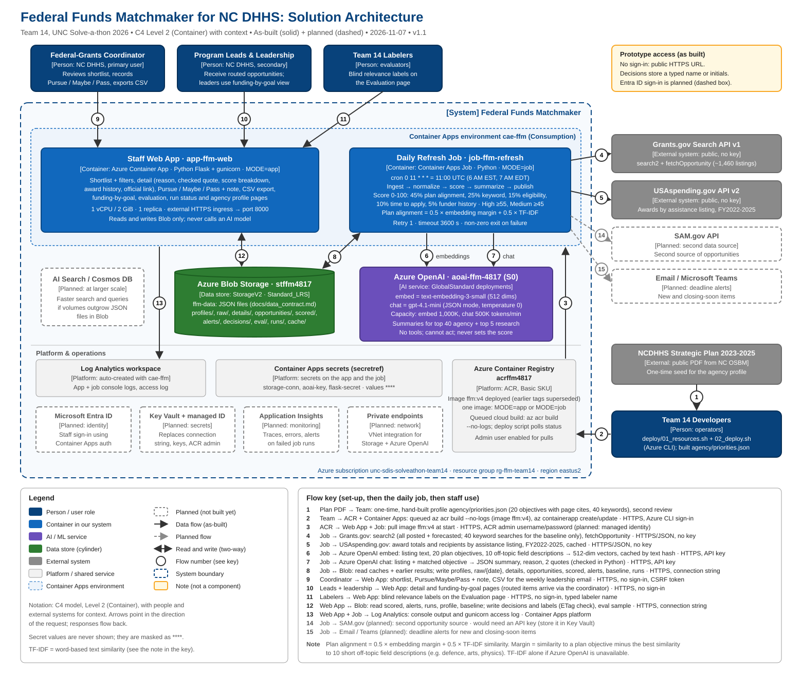

# Solution Design: Federal Funds Matchmaker for NC DHHS

Team 14 · UNC Solve-a-thon 2026 · Version 1.0, 7 November 2026

## 1. Problem and users

**Problem.** The NC DHHS federal-grants coordinator scans hundreds of Grants.gov notices a week by hand and
still misses relevant ones. On 7 November 2026 there were **1,460** posted and forecasted federal
opportunities; a keyword search on the Department's own topics returns **1,305** of them, far too many to read.

**Users.** The grants coordinator (primary): reviews the shortlist, records decisions, sends a weekly list
to leadership. Division program leads receive routed opportunities. DHHS leadership uses the funding-by-goal
view.

**Requirements we designed to.**
1. **Daily**: refreshes itself every morning without anyone pressing a button.
2. **Explainable**: every rank has a published breakdown; every AI claim has a quote checked against the listing.
3. **Human decides**: the system ranks and explains, staff record Pursue / Maybe / Pass.
4. **Works with a real plan**: grounded in the NCDHHS Strategic Plan 2023–2025, with page citations.

## 2. Architecture

*Figure 1. One container image, two roles. The job writes JSON to Blob Storage; the web app reads it and saves
staff decisions. Full architecture and threat-model report: `docs/diagrams/ffm-architecture-security/report.html`.*

**How data flows**
1. **Seed (once):** our team turned the strategic plan into a structured profile (5 goals, 20 objectives with
   page numbers, 40 keywords, 12 program areas, 13 divisions, eligible applicant type). A second teammate reviewed it.
2. **Ingest (daily, 6:00 AM Eastern):** the job calls the Grants.gov API for every posted and forecasted
   opportunity and its full listing, plus one search per profile keyword (recorded only for the baseline).
   Raw responses are kept by date for audit and replay.
3. **Normalize:** records are mapped to one schema using the qualifier's tested rules; closed, archived and
   administrative notices are dropped; duplicates removed by opportunity number; incomplete records flagged.
4. **Score:** each opportunity gets a 0–100 score with a five-part breakdown (section 4).
5. **Summarize:** only the top 45 get an AI summary and "why it matches", with quotes our code verifies.
6. **Serve:** the web app shows the ranked shortlist; staff decisions are written back to Blob.
7. **Learn:** hand labels and decisions feed the Evaluation page (precision@10, decisions vs scores).

## 3. Azure services

| Service | Name | Role | Setting |
|---|---|---|---|
| Resource group | `rg-ffm-team14` | Everything in one place; teardown is one command | East US 2 |
| Blob Storage | `stffm4817` / container `ffm-data` | All state as JSON (data contract below) | Standard_LRS, TLS 1.2, no public blob access |
| Azure OpenAI | `aoai-ffm-4817` | `embed` = text-embedding-3-small; `chat` = gpt-4.1-mini | GlobalStandard; 1,000K / 500K tokens per minute |
| Container Registry | `acrffm4817` | One image (`ffm`), built in the cloud | Basic |
| Container Apps environment | `cae-ffm` | HTTPS ingress, logging (Log Analytics) | Consumption |
| Container App | `app-ffm-web` | Staff web app (`MODE=app`) | 1 vCPU / 2 GiB, 1 replica |
| Container Apps Job | `job-ffm-refresh` | Daily pipeline (`MODE=job`) | Daily at 11:00 UTC (6 AM EST, 7 AM EDT), 1 retry, 1 h timeout |

**Cost.** About $2–3 a day at pilot scale, mostly the always-on web app; AI costs well under $0.10 a day
because embeddings are cached and only 45 summaries are written. There are no databases or clusters to manage.

## 4. Scoring method

Each signal is between 0 and 1; the score is 100 × the weighted sum. Weights follow the starter kit's recipe.

| Signal | Weight | How it is measured |
|---|---|---|
| Plan alignment | 45% | Average of (a) **embedding margin**: similarity to each plan objective minus similarity to the nearest of ten unrelated fields (defence, arts, physics, …), and (b) **TF-IDF** word similarity. The best objective becomes the matched goal |
| Keyword / program fit | 25% | Profile keywords found; a title hit counts double; full credit at 4 |
| Eligibility | 15% | 1 if state governments are listed (or the text names state agencies); 0.8 unrestricted; 0.4 unclear; 0 if the text limits applicants to universities, tribes or individuals |
| Time to apply | 10% | Full credit at 60+ days left, none at 0; forecasts 0.7; out-of-date forecasts 0.3 |
| Funder history | 5% | USAspending.gov FY2022–25: NC DHHS received awards under this assistance listing (1.0), other state agencies receive ≥25% (0.7), otherwise lower |

**Confidence:** High ≥ 55, Medium ≥ 45, Low below. Low is hidden by default, one click away.
**Separate lists:** NIH-style research mechanisms (R01, U01, …) go to a "research (university partner)" list;
records whose eligibility excludes state agencies go to "not eligible". Nothing is deleted.

**Why this design, with numbers.** We tuned the plan-alignment signal on the 1,037 live opportunities that the
qualifier's AI pipeline had already reviewed (`src/tune_semantic.py`). Against whether they are on topic for DHHS:
raw embeddings AUC 0.84 (54% of the top 50 on topic), TF-IDF 0.81 (50%), **hybrid 0.91 (76%)**. The full
five-signal score reaches **AUC 0.91** against "on topic and DHHS can apply". Raw embeddings put a Navy research
announcement among the top matches; the margin against unrelated fields fixed that.

**What the AI may and may not do.** The AI never sets the score. It may (a) move a record to "not eligible" only
with an eligibility quote our code verified, or (b) lower confidence one step when it says the match is weak.
Both are shown on the record.

## 5. Data contract

All components read and write JSON at fixed paths in `ffm-data` (full field list: `docs/data_contract.md`).

| Path | Written by | Read by |
|---|---|---|
| `profiles/{agency}.json` | job (from reviewed repo file) | app |
| `raw/{date}/grants.json`, `details/{id}.json` | job: ingest | job: replay, audit |
| `opportunities/latest.json` | job: normalize | anyone |
| `scored/{agency}/latest.json` | job: score + summarize | app |
| `alerts/{agency}/latest.json` | job | app |
| `decisions/{agency}.json` | app | app, evaluation |
| `eval/sample.json`, `eval/labels.json` | app | evaluation |
| `runs/{timestamp}.json` | job | app (status page) |

Minimum opportunity schema: `id, source, number, title, agency, status, open_date, close_date, days_to_close,
eligibility, category, award_ceiling, description, url, ingested_at` plus quality flags.

## 6. Threats and mitigations

The full STRIDE threat model with trust boundaries is in `docs/diagrams/ffm-architecture-security/report.html`.
The main threats:

| Threat | Severity | Mitigation | Status |
|---|---|---|---|
| **Inconsistent data quality** (missing dates, placeholder amounts like $999,999,999, HTML in text) | Medium | One schema; the qualifier's tested rules; incomplete records flagged, not dropped; raw data kept | Implemented |
| **False positives** (generic announcements look relevant) | Medium | Embedding margin vs unrelated fields; breakdown and matched goal on every record; Low hidden by default | Implemented |
| **False negatives** (short or vague listings) | High impact | Low matches kept one click away; keyword-search coverage and recall on hand labels measured | Implemented |
| **AI hallucination** (invented facts or quotes) | High | "Not stated" rule; every quote checked word for word and hidden if not found; problems logged; staff decide | Implemented |
| **Prompt injection** in third-party listing text | Medium | Model has no tools and cannot act; JSON output validated; it cannot change the score | Implemented |
| **Anyone with the URL can record a decision** (no sign-in) | High | Decisions keep name, time and full history | **Gap**: Entra ID sign-in planned |
| **Secrets exposure** | Medium | Keys only as Container Apps secrets; `.env` ignored by git and the image build | Implemented; Key Vault + managed identity planned |
| **Web attacks** (XSS, CSRF, clickjacking) | Medium | Auto-escaping, CSRF token on every form, strict Content-Security-Policy, X-Frame-Options DENY | Implemented |
| **Grants.gov outage** | Medium | Retries; the job refuses to publish if fewer than 50 listings arrive, so yesterday's list stays; replay from saved raw data | Implemented |
| **Runaway AI cost** | Low | Only the top 45 summarized; embeddings cached; per-minute capacity limits | Implemented |
| **Uneven agency documentation** | Medium | One profile template for every agency; every goal cites a page; second-person review | Implemented (one agency) |

## 7. Pilot and scaling

**60-day pilot:** 2–3 agencies, one coordinator each, weekly review. Coordinators keep their manual check so
recall can be measured fairly. Success = hours saved per week, opportunities pursued that would otherwise have
been missed, precision at or above target.

**To production:** Entra ID sign-in (Container Apps built-in authentication); Key Vault with managed identity
for every secret; Application Insights; private endpoints for Storage and Azure OpenAI; a profile per agency
in the same template; email or Teams deadline alerts; feedback-tuned weights from Pursue/Pass decisions;
Azure AI Search or Cosmos DB if volumes grow. The architecture does not change shape.
